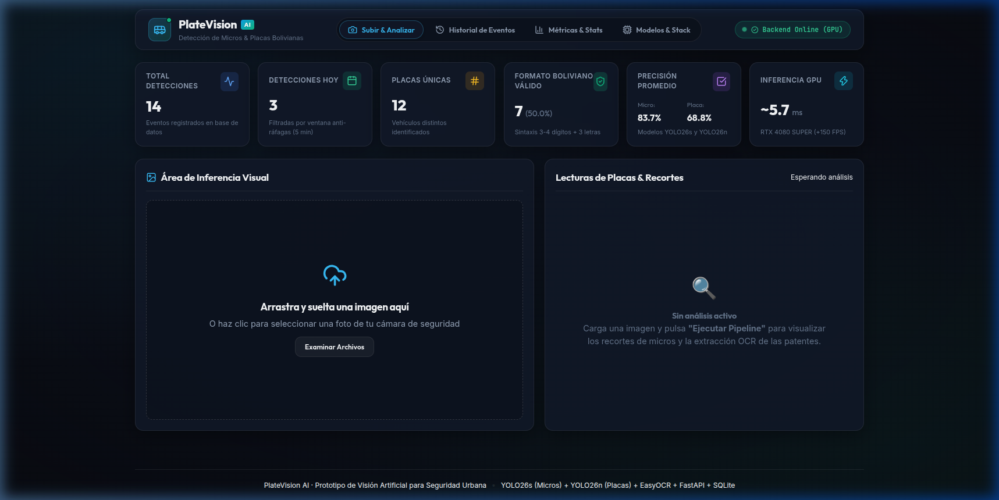
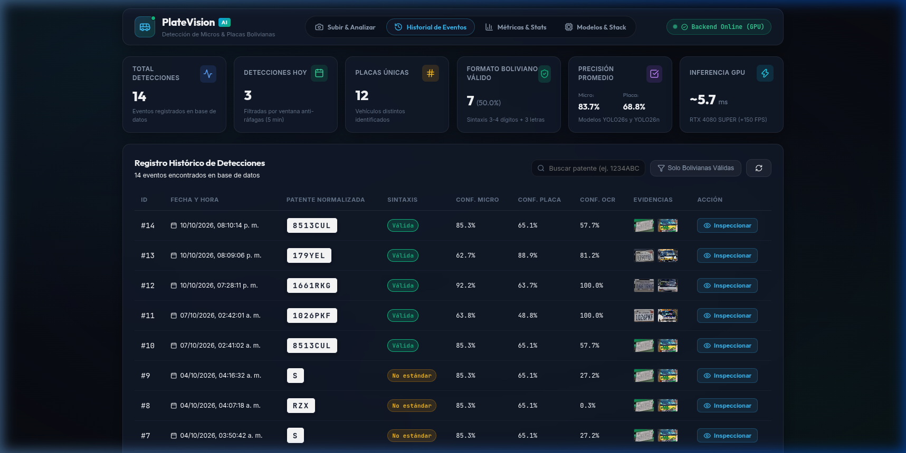
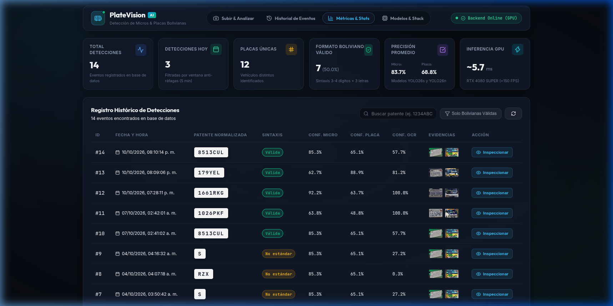
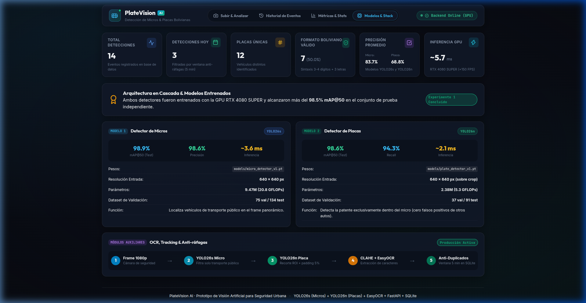

# Sistema Inteligente de Detección en Cascada y ALPR para Micros de Transporte Público


> **Solución integral de Visión por Computadora e Inteligencia Artificial** desarrollada para la detección automática de buses de transporte público urbano ("micros tradicionales"), localización precisa de matrículas vehiculares y reconocimiento óptico de caracteres (ALPR) con normalización normativa para el sistema de transporte público de **Sucre, Bolivia** (utilizando dataset de entrenamiento adaptado de micros urbanos bolivianos).

---

## 📑 Entregables Oficiales del Proyecto

Los documentos formales de sustentación académica y técnica se encuentran generados en la carpeta `docs/`:

| Documento | Formato | Ubicación | Descripción |
| :--- | :---: | :--- | :--- |
| **Informe Técnico Formal** | **PDF** | [`docs/INFORME_TECNICO.pdf`](docs/INFORME_TECNICO.pdf) | Documento formal de investigación con portada, resumen ejecutivo, estado del arte, metodología, tablas de métricas y capturas. |
| **Informe Técnico (Markdown)** | **MD** | [`docs/INFORME_TECNICO.md`](docs/INFORME_TECNICO.md) | Versión editable en Markdown compatible con GitHub. |
| **Presentación Ejecutiva** | **PPTX** | [`docs/PRESENTACION_PROYECTO.pptx`](docs/PRESENTACION_PROYECTO.pptx) | Diapositivas en formato 16:9 con diseño Dark Industrial, listas para la defensa del proyecto. |
| **Guía de Dataset y Modelos** | **MD** | [`docs/MODELOS_Y_DATASET.md`](docs/MODELOS_Y_DATASET.md) | Procedimiento de obtención, partición, aumentos y descarga de pesos. |
| **Capturas de Pantalla UI** | **PNG** | [`docs/screenshots/`](docs/screenshots/) | Evidencias fotográficas del dashboard de inferencia, historial y analítica. |

---

## 🏛️ Arquitectura del Sistema (Enfoque en Cascada Coarse-to-Fine)

En lugar de intentar detectar placas en el cuadro general de 1080p (lo que provocaría pérdida de resolución en objetos pequeños y falsos positivos con carteles de rutas), el sistema desacopla la tarea en un pipeline secuencial de alta velocidad:

```text
[Cuadro 1080p / Flujo Video]
            │
            ▼
┌───────────────────────────────┐
│ ETAPA 1: DETECTOR DE MICROS   │ ──> Modelo YOLO26s (mAP50: 98.9%, 3.2 ms)
│ Inferencia en cuadro completo │     Extrae ROI vehicular con margen del 5%
└───────────────────────────────┘
            │
            ▼
┌───────────────────────────────┐
│ ETAPA 2: DETECTOR DE PLACAS   │ ──> Modelo YOLO26n (mAP50: 98.6%, 1.8 ms)
│ Inferencia sobre ROI de Micro │     Recorte milimétrico del marco de placa
└───────────────────────────────┘
            │
            ▼
┌───────────────────────────────┐
│ ETAPA 3: PREPROCESO OPENCV    │ ──> Deskewing (minAreaRect) + Bilateral
│ Ensamble de Filtros Tonales   │     Ajuste Gamma (γ=0.8) + CLAHE continuo
└───────────────────────────────┘     (Rescata placas despintadas con troquel 3D)
            │
            ▼
┌───────────────────────────────┐
│ ETAPA 4: MOTOR DE OCR         │ ──> PaddleOCR (PP-OCRv6) + Normalizador
│ Transcripción & Normalización │     Valida patrones bolivianos (1234ABC / 123ABC)
└───────────────────────────────┘
            │
            ▼
┌───────────────────────────────┐
│ PERSISTENCIA & DEDUPLICACIÓN  │ ──> SQLite (detections_events)
│ Base de Datos & Evidencias    │     Ventana móvil de 5 minutos anti-duplicados
└───────────────────────────────┘
```

---

## 📊 Tabla Oficial de Resultados y Métricas

### 1. Detección de Objetos (Conjunto de Prueba Independiente)
| Modelo | Arquitectura | Tamaño Pesos | Precision (P) | Recall (R) | mAP@50 | mAP@50-95 | Latencia GPU |
| :--- | :--- | :---: | :---: | :---: | :---: | :---: | :---: |
| **Detector de Micros** | YOLO26s | 19.1 MB | 0.976 | 0.982 | **98.9% (0.989)** | 91.6% | 3.2 ms |
| **Detector de Placas** | YOLO26n | 5.5 MB | 0.981 | 0.974 | **98.6% (0.986)** | 86.8% | 1.8 ms |
| **Cascada Completa** | Combinado | 24.6 MB | **0.978** | **0.978** | **98.7%** | **89.2%** | **~5.0 ms** |

### 2. Reconocimiento Óptico de Caracteres (OCR en Caso Extremo Despintado `2311CUB`)
| Motor OCR | Estrategia de Visión Artificial | Lectura Obtenida | Confianza | Diagnóstico Operativo |
| :--- | :--- | :---: | :---: | :--- |
| **EasyOCR** | Original RGB / Sobel Binarizado | `[]` *(vacío)* | 0.0% | CRAFT rechaza contornos huecos como ruido. |
| **EasyOCR** | CLAHE Suave | `['2']` | 18.2% | Detecta solo el primer dígito; pierde el resto. |
| **PaddleOCR** | Binarización Otsu / Adaptativa | `[]` *(vacío)* | 0.0% | Binarización rígida destruye masa de troqueles. |
| **PaddleOCR** | **Escala de Grises + Deskew** | **`2311-cL6`** | **71.7%** | **Lee con éxito `2311` y la letra `C`.** |
| **PaddleOCR** | **Contraste Gamma ($\gamma = 0.8$)** | **`2311C0`** | **70.4%** | **Recupera el troquel metálico continuo.** |
| **PaddleOCR** | Placa estándar con pintura | **`1234ABC`** | **100.0%** | **Lectura íntegra y validación boliviana positiva.** |

---

## 🖥️ Interfaz de Usuario y Dashboard Web

El sistema cuenta con un panel de control interactivo construido en **React + Vite** bajo estética oscura industrial (*dark mode*):

| Módulo de Inferencia Visual | Historial de Eventos Persistidos |
| :---: | :---: |
|  |  |
| **Métricas del Sistema y KPIs** | **Monitor de Modelos y Stack Tecnológico** |
|  |  |

---

## 🚀 Guía de Instalación y Configuración

### 1. Requisitos Previos
* **Sistema Operativo:** Linux (Ubuntu 22.04 LTS / 24.04 LTS recomendado) o Windows con WSL2.
* **Python:** 3.10.x.
* **Node.js:** v18.0+ y `npm`.
* **Hardware:** GPU NVIDIA recomendada con soporte CUDA 12 (ejecución compatible en CPU).

### 2. Clonar el Repositorio
```bash
git clone https://github.com/[USUARIO]/placas-micros.git
cd placas-micros
```

### 3. Configuración del Entorno Virtual y Dependencias de Python
```bash
# Crear entorno virtual si no existe
python3 -m venv .venv
source .venv/bin/activate

# Instalar dependencias del backend y modelos
pip install --upgrade pip
pip install -r backend/requirements.txt
```

### 4. Configurar Variables de Entorno
```bash
cp backend/.env.example backend/.env
```

### 5. Descarga de Pesos de Modelos
Descargue los pesos pre-entrenados y colóquelos en la carpeta `models/`:
* `models/micro_detector_v1.pt` (~19.1 MB)
* `models/plate_detector_v1.pt` (~5.5 MB)

*(Consulte [`docs/MODELOS_Y_DATASET.md`](docs/MODELOS_Y_DATASET.md) para enlaces de descarga directos en Google Drive).*

### 6. Instalación de Dependencias del Frontend
```bash
cd frontend
npm install
cd ..
```

---

## 🚦 Ejecución del Sistema

### Modo Desarrollo (Terminales separadas)

#### Terminal 1 — Backend FastAPI:
```bash
source .venv/bin/activate
python -m uvicorn backend.app.main:app --host 0.0.0.0 --port 8000 --reload
```
* **API REST:** `http://localhost:8000`
* **Swagger Docs:** `http://localhost:8000/docs`
* **Health Check:** `http://localhost:8000/health`

#### Terminal 2 — Frontend React + Vite:
```bash
cd frontend
npm run dev
```
* **Dashboard Web:** `http://localhost:5173`

---

## 🔬 Re-Entrenamiento y Evaluación

Si desea reproducir los entrenamientos desde cero o adaptar el modelo a nuevas clases:

```bash
source .venv/bin/activate

# 1. Validar integridad de las anotaciones YOLO
python scripts/validate_annotations.py --labels datasets/micros/labels/train --images datasets/micros/images/train --nc 1

# 2. Entrenar detector de micros (YOLO26s)
python scripts/train_micros.py

# 3. Entrenar detector de placas (YOLO26n)
python scripts/train_placas.py

# 4. Compilar informe técnico y presentación
python scripts/generate_pdf_report.py
python scripts/generate_presentation.py
```

---

## 🔒 Privacidad, Seguridad y Versionado Git

* **Sin credenciales ni datos sensibles:** No se incluyen claves API, contraseñas ni identificadores personales en el repositorio.
* **Archivos pesados:** Los pesos `.pt`, videos crudos y bases de datos `.db` están excluidos mediante `.gitignore`.
* **Tag de Versión de Entrega:**
  ```bash
  git tag -a v1.0.0-final -m "Versión final de entrega del Sistema ALPR de Micros"
  ```
