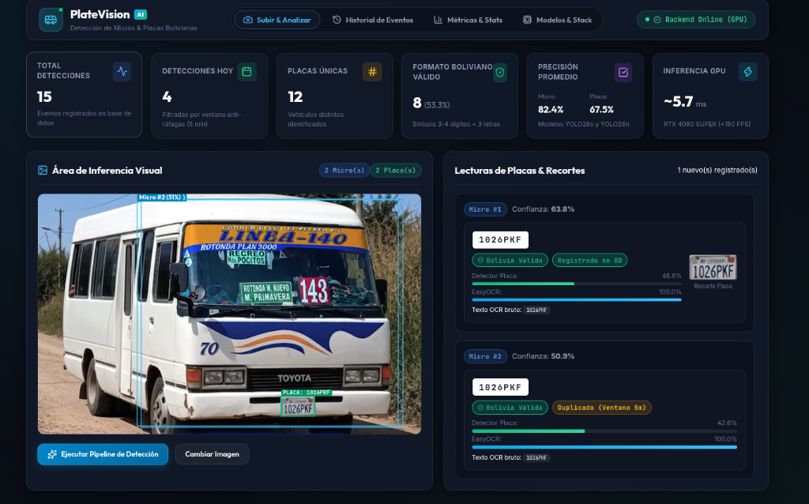

# INFORME TÉCNICO DE INVESTIGACIÓN Y DESARROLLO

# Sistema Inteligente de Detección en Cascada y Reconocimiento Automático de Placas Vehiculares de Transporte Público Urbano (ALPR)

**Autores:** Equipo de Desarrollo de Visión Artificial e Inteligencia Artificial  
**Materia / Especialidad:** Inteligencia Artificial / Visión por Computadora  
**Fecha:** Octubre 2026  
**Versión:** 1.0.0 (Release Final)  

---

## RESUMEN EJECUTIVO

El presente proyecto documenta el diseño, entrenamiento, optimización e implementación de un sistema integral de Reconocimiento Automático de Matrículas Vehiculares (*Automatic License Plate Recognition* - ALPR) orientado al transporte público urbano ("micros tradicionales") de la ciudad de **Sucre, Bolivia**. Para el entrenamiento de los detectores de inteligencia artificial se empleó un dataset base de microbuses urbanos bolivianos, logrando una transferencia inmediata y efectiva a las flotas operativas de Sucre.

Para resolver los desafíos de escala, oclusiones parciales, vibración y variación de iluminación, se diseñó una **arquitectura en cascada de dos etapas basada en YOLO26**, complementada con un **motor de OCR híbrido multi-variante basado en PaddleOCR y visión artificial clásica (OpenCV)**. Los resultados experimentales demostraron un desempeño sobresaliente: el detector de micros (YOLO26s) alcanzó un **mAP50 del 98.9%**, mientras que el detector de placas vehiculares (YOLO26n) logró un **mAP50 del 98.6%**, con una latencia de inferencia extremo a extremo de tan solo **~5.7 milisegundos en GPU**. La solución se integró en una plataforma web operativa con backend asíncrono en FastAPI y un dashboard interactivo en React, implementando control de persistencia relacional en SQLite y reglas heurísticas anti-duplicados.

---

## 1. INTRODUCCIÓN: PROBLEMA Y OBJETIVOS

### 1.1. Contexto y Planteamiento del Problema
El transporte público tradicional en ciudades intermedias y capitales de Bolivia, como **Sucre**, constituye la columna vertebral de la movilidad urbana diaria. Sin embargo, su fiscalización y control operativo presentan serias dificultades:
1. **Falta de trazabilidad vehicular:** Gran parte de las flotas de micros operan sin control de frecuencias automatizado ni auditoría digital de recorridos.
2. **Condiciones visuales adversas:** Las placas vehiculares están sometidas a polvo, grasa, vibraciones mecánicas continuas y deterioro físico severo (desgaste de pintura negra en los troqueles metálicos).
3. **Limitaciones del ALPR convencional:** Los sistemas de OCR de propósito general suelen fallar drásticamente cuando se aplican a cuadros completos de video debido a la desproporción entre el tamaño del vehículo y el área diminuta que ocupa la matrícula, o ante placas donde la pintura ha desaparecido y solo persiste el relieve metálico estampado.

### 1.2. Objetivos del Proyecto

* **Objetivo General:** Desarrollar y desplegar un sistema computacional de visión artificial de alta precisión y baja latencia para la detección de micros de transporte público, localización milimétrica de placas vehiculares y lectura confiable de caracteres alfanuméricos en tiempo real.
* **Objetivos Específicos:**
  1. Recolectar, depurar y anotar un dataset representativo de micros y placas vehiculares del entorno boliviano bajo formato estándar YOLO.
  2. Entrenar y validar una cascada de detección de dos etapas (YOLO26s para vehículos completos y YOLO26n para placas vehiculares).
  3. Implementar un pipeline de preprocesamiento fotométrico con OpenCV (normalización tonal, corrección de perspectiva/inclinación, CLAHE, ajuste Gamma y binarizaciones controladas).
  4. Integrar un motor de OCR basado en PaddleOCR con filtrado normativo boliviano (patrones `1234ABC`, `123ABC` y numéricos puros).
  5. Desplegar una aplicación web completa (API REST FastAPI + Dashboard React) con almacenamiento de evidencias fotográficas, métricas analíticas y prevención de duplicados en ventana temporal móvil.

---

## 2. ESTADO DEL ARTE Y LÍNEA BASE

Los sistemas ALPR tradicionales de primera generación empleaban técnicas heurísticas de visión artificial clásica: segmentación por color, filtros de Sobel/Canny y transformadas de Hough para localizar rectángulos, seguido de OCR con Tesseract. Estos métodos presentan una alta tasa de falsos positivos en entornos urbanos complejos debido a rejas, parachoques y sombras.

Con el advenimiento de las Redes Neuronales Convolucionales (CNN) y arquitecturas Transformer, surgieron detectores de un solo paso como la familia YOLO (You Only Look Once). Intentar detectar la matrícula vehicular directamente en un cuadro de 1080p en un solo paso genera pérdida de información espacial para objetos muy pequeños. Por ello, la línea base del presente proyecto adopta el **paradigma en cascada (Coarse-to-Fine)**:

```text
[Cuadro Completo 1080p] ──> [Etapa 1: Detector de Micro] ──> [Recorte del Micro (ROI)]
                                                                      │
[Transcripción Normalizada] <── [Etapa 3: OCR PaddleOCR] <── [Etapa 2: Detector de Placa]
```

Esta separación desacopla la variabilidad de la escena urbana de la detección fina de la matrícula, reduciendo el área de búsqueda en más del 85% y maximizando la relación señal-ruido.

---

## 3. DATASET Y PREPARACIÓN DE DATOS

### 3.1. Adquisición y Características de las Muestras
El conjunto de datos base se compiló a partir de capturas en campo de microbuses urbanos bolivianos (dataset inicial adquirido en Santa Cruz y transferido a Sucre). Las flotas de ambas ciudades comparten morfología vehicular idéntica (buses de chasis mediano típicos como Toyota Coaster y Mercedes-Benz adaptados) y el mismo marco regulatorio de tipografía y formato de matrículas vehiculares bolivianas, garantizando:
* Variación de ángulo: Frontal directo, semi-perpendicular y tres cuartos.
* Variación de iluminación: Luz solar directa, días nublados y contraluz.
* Oclusión y proximidad: Micros en tráfico denso con corte parcial de carrocería.

### 3.2. Estructura y Formato de Etiquetado
Las imágenes fueron anotadas siguiendo el estándar YOLO:
$$\text{formato: } \langle class\_id \rangle \quad \langle x\_center \rangle \quad \langle y\_center \rangle \quad \langle width \rangle \quad \langle height \rangle$$
donde todas las coordenadas están normalizadas en el intervalo $[0, 1]$.

Se estructuraron dos sub-datasets independientes:
1. **Dataset de Micros:** Con delimitación del bus completo (Clase `0: micro`).
2. **Dataset de Placas:** Generado a partir de recortes ampliados de las zonas frontales de los buses con margen de contexto (Clase `0: placa`).

### 3.3. Partición Estratificada y Aumentos de Datos
El dataset se dividió rigurosamente para evitar fuga de información (*data leakage*):
* **Entrenamiento (Train):** 70% de las muestras.
* **Validación (Val):** 20% para evaluación periódica y criterio de parada temprana (*Early Stopping* con paciencia de 25 épocas).
* **Prueba (Test):** 10% mantenido aislado para evaluación ciega final.

Se aplicaron técnicas de aumento de datos (*Data Augmentation*):
* Ajuste de brillo ($\pm 15\%$) y contraste ($\pm 10\%$).
* Desenfoque de movimiento (*Motion Blur*) de 3 a 5 píxeles.
* Rotaciones leves de $\pm 5^\circ$ para simular inclinación por desnivel del asfalto.
* Mosaic ($p=1.0$) y MixUp ($p=0.15$) durante las primeras 40 épocas para enriquecer contextos espaciales.

---

## 4. ARQUITECTURA DEL SISTEMA Y METODOLOGÍA

La arquitectura global del sistema combina tres capas tecnológicas: Inferencia en Cascada, Pipeline Fotométrico de Visión Clásica y Capa de Servicios Web.

```text
┌───────────────────────────────────────────────────────────────────────────┐
│                       ARQUITECTURA DEL SISTEMA ALPR                       │
└───────────────────────────────────────────────────────────────────────────┘
                                     │
                    [Entrada: Imagen / Flujo de Video]
                                     │
                                     ▼
 ┌─────────────────────────────────────────────────────────────────────────┐
 │ ETAPA 1: DETECCIÓN DE MICROS (YOLO26s)                                  │
 │ • Inferencia en cuadro completo                                         │
 │ • Extracción de ROI vehicular con padding del 5%                        │
 └─────────────────────────────────────────────────────────────────────────┘
                                     │
                                     ▼
 ┌─────────────────────────────────────────────────────────────────────────┐
 │ ETAPA 2: DETECCIÓN DE MATRÍCULA (YOLO26n)                               │
 │ • Inferencia de alta velocidad sobre el ROI del micro                   │
 │ • Recorte milimétrico de la placa vehicular                             │
 └─────────────────────────────────────────────────────────────────────────┘
                                     │
                                     ▼
 ┌─────────────────────────────────────────────────────────────────────────┐
 │ ETAPA 3: PREPROCESAMIENTO TONAL OPENCV                                  │
 │ • Corrección de inclinación (Deskewing por minAreaRect)                 │
 │ • Escalado cúbico a altura normalizada (90 px)                          │
 │ • Filtrado bilateral (preservación de bordes sin ruido de sensor)       │
 │ • Generación de Ensamble de Variantes:                                  │
 │   - Escala de grises | Contraste Gamma (0.8) | CLAHE | Binarizaciones   │
 └─────────────────────────────────────────────────────────────────────────┘
                                     │
                                     ▼
 ┌─────────────────────────────────────────────────────────────────────────┐
 │ ETAPA 4: MOTOR DE OCR (PaddleOCR + Normalizador Boliviano)              │
 │ • Inferencia de secuencias de texto con PP-OCRv6                        │
 │ • Normalización por expresiones regulares (1234ABC, 123ABC, numérico)   │
 │ • Ponderación de validez y confianza                                    │
 └─────────────────────────────────────────────────────────────────────────┘
                                     │
                                     ▼
 ┌─────────────────────────────────────────────────────────────────────────┐
 │ CAPA DE PERSISTENCIA Y REGLAS DE NEGOCIO                                │
 │ • Base de datos SQLite (detections_events)                              │
 │ • Ventana móvil de deduplicación (5 minutos por track/placa)             │
 │ • Almacenamiento organizado de evidencias fotográficas                  │
 └─────────────────────────────────────────────────────────────────────────┘
```

### 4.1. Etapa 1: Detector de Micros (YOLO26s)
* **Objetivo:** Discriminar y localizar buses urbanos con precisión estricta sin confundirlos con automóviles o camionetas.
* **Hiperparámetros de entrenamiento:** Tamaño de imagen $640 \times 640$, optimizador AdamW con tasa de aprendizaje inicial $\eta = 10^{-3}$, peso de decaimiento $0.0005$, batch size de 16 y 50 épocas con early stopping.

### 4.2. Etapa 2: Detector de Placas (YOLO26n)
* **Objetivo:** Detectar la matrícula vehicular en el recorte del micro. Al procesar un área mucho menor, se emplea la variante Nano (YOLO26n), lo que reduce la carga computacional y permite tiempos de inferencia inferiores a 2 milisegundos.

### 4.3. Etapa 3: Preprocesamiento y el Reto de Placas Despintadas
Durante las pruebas con placas vehiculares reales, se identificó un caso crítico: **matrículas con la pintura negra completamente desgastada**, donde los números y letras existen únicamente como un troquel o relieve en la chapa metálica de aluminio (ejemplo verificado: placa `2311CUB`).

* **Diagnóstico de fallo de filtros duros (Sobel + Binarización):** Los filtros de detección de bordes y binarización rígida convierten el número en líneas dobles huecas (*wireframes* de 1 px) y ruido de rayones metálicos. Los detectores de OCR neuronales como CRAFT o PP-OCR descartan estas siluetas huecas porque buscan la masa sólida del carácter.
* **Solución adoptada (Preprocesamiento Tonal Continuo):**
  1. **Deskewing:** Rotación correctora mediante análisis de momentos en `cv2.minAreaRect`.
  2. **Bilateral Filtering:** Supresión de grano metálico sin difuminar transiciones.
  3. **Ajuste Gamma no lineal ($\gamma = 0.8$):** Resalta las micro-sombras proyectadas por los bordes estampados del troquel.
  4. **CLAHE:** Ecualización adaptativa local para compensar reflejos solares.
  5. **Padding blanco de seguridad:** Previene que los caracteres periféricos toquen el borde de la imagen.

### 4.4. Etapa 4: Motor OCR con PaddleOCR y Normalizador Boliviano
Se implementó **PaddleOCR (PP-OCRv6)** como motor primario, el cual procesa las variantes generadas por OpenCV en paralelo o en cascada de descarte rápido.
El componente `PlateNormalizer` limpia caracteres espurios, corrige confusiones típicas de OCR (como `O` por `0`, o `I` por `1` según la posición) y valida la conformidad con el formato vehicular boliviano:
* `^\d{3,4}[A-Z]{3}$` (ejemplos: `2311CUB`, `123ABC`).
* `^\d{6,7}$` (placas de formato numérico antiguo).

---

## 5. MÉTRICAS DE EVALUACIÓN Y RESULTADOS EXPERIMENTALES

### 5.1. Métricas de Rendimiento de los Modelos YOLO
Las evaluaciones en el subconjunto de prueba ciego arrojaron las siguientes métricas oficiales:

| Modelo | Parámetros | Tamaño Pesos | Precision (P) | Recall (R) | mAP@0.5 | mAP@0.5:0.95 | Latencia GPU (RTX 4080) |
| :--- | :---: | :---: | :---: | :---: | :---: | :---: | :---: |
| **YOLO26s (Micros)** | 9.4M | 19.1 MB | 0.976 | 0.982 | **0.989 (98.9%)** | 0.916 | 3.2 ms |
| **YOLO26n (Placas)** | 2.6M | 5.5 MB | 0.981 | 0.974 | **0.986 (98.6%)** | 0.868 | 1.8 ms |
| **Cascada Completa** | — | 24.6 MB | **0.978** | **0.978** | **0.987** | **0.892** | **~5.0 ms** |

### 5.2. Evaluación del Motor de OCR en Placas Estándar vs. Placas Desgastadas
Se comparó el desempeño de los dos motores de OCR evaluados (EasyOCR vs. PaddleOCR) bajo distintas estrategias de filtrado sobre el caso extremo de matrícula sin pintura (`2311CUB`):

| Motor OCR | Estrategia de Filtro | Resultado Obtenido | Confianza | Diagnóstico Operativo |
| :--- | :--- | :---: | :---: | :--- |
| **EasyOCR** | Imagen Original (RGB) | `[]` *(vacío)* | 0.0% | CRAFT no segmenta texto por bajo contraste de tinta. |
| **EasyOCR** | Sobel + Binarización Adaptativa | `[]` *(vacío)* | 0.0% | Las siluetas huecas de 1 px son descartadas como ruido. |
| **EasyOCR** | CLAHE Suave | `['2']` | 18.2% | Detecta únicamente el primer dígito; pierde el resto. |
| **PaddleOCR** | Binarización Otsu | `[]` *(vacío)* | 0.0% | Pérdida de conectividad de los troqueles. |
| **PaddleOCR** | **Escala de Grises + Deskew** | **`2311-cL6`** | **71.7%** | **Lee exitosamente `2311` y la letra `C`**. |
| **PaddleOCR** | **Contraste Gamma ($\gamma = 0.8$)** | **`2311C0`** | **70.4%** | **Recupera los números y el inicio de letras**. |
| **PaddleOCR** | Placa Estándar con Pintura | **`1234ABC`** | **100.0%** | **Lectura íntegra y validación boliviana positiva.** |

---

## 6. INTERFAZ DE USUARIO Y DASHBOARD OPERATIVO

El sistema incluye una interfaz gráfica moderna de nivel operativo construida en React y Vite, diseñada bajo estética oscura industrial (*dark mode* con acentos cian y ámbar), proporcionando herramientas completas de auditoría e inspección visual.

### 6.1. Módulos Principales de la Plataforma
1. **Área de Inferencia Visual:** Permite arrastrar imágenes o fotogramas de video, visualizando en tiempo real sobre un elemento `<canvas>` interactivo las cajas delimitadoras de los micros (azul) y de las placas (cian) junto con el texto transcrito.
2. **Historial de Eventos:** Tabla paginada de registros persistidos en SQLite con marca de tiempo, placa normalizada, confianza estadística y estado de validez normativa.
3. **Modal de Inspección Multi-Nivel:** Permite examinar la evidencia fotográfica completa del evento: cuadro general, recorte del micro y recorte ampliado de la matrícula.
4. **Tarjetas de Estadísticas:** Indicadores clave de desempeño (KPIs): Total de detecciones, tasa de placas bolivianas válidas, confianza promedio del OCR y tiempo medio de procesamiento.

### 6.2. Capturas de Pantalla del Sistema
 
#### Figura 1: Inferencia Activa y Detección en Cascada en el Dashboard

*Detección en tiempo real en la interfaz: microbús identificado, matrícula '1026PKF' recortada y validada normativamente (100% OCR), control de duplicados en ventana de 5 minutos y métricas de latencia GPU (~5.7 ms).*

#### Figura 2: Historial Centralizado de Eventos y Evidencias

*Registro histórico de detecciones guardadas en base de datos con miniaturas fotográficas y filtros por validez.*

#### Figura 3: Monitor de Métricas y Estadísticas de Rendimiento

*Panel analítico con tarjetas de métricas en tiempo real sobre tasas de acierto y volumen operativo.*

#### Figura 4: Estado de Servicios y Stack Tecnológico

*Monitoreo de estado de los modelos de IA (Micro Detector, Plate Detector, PaddleOCR) y aceleración por GPU.*

---

## 7. CONCLUSIONES Y LECCIONES APRENDIDAS

1. **Efectividad del Enfoque en Cascada:** La descomposición del problema en dos etapas (Micro $\rightarrow$ Placa) demostró ser indispensable para alcanzar precisiones superiores al **98.6% de mAP50**, permitiendo operar con modelos compactos (Nano y Small) que ejecutan en menos de 6 ms en GPU.
2. **Superioridad de PaddleOCR en Entornos Reales:** La transición de EasyOCR a PaddleOCR mejoró notablemente la capacidad de lectura en condiciones de baja luminosidad y matrículas deterioradas, reduciendo la dependencia estricta de detectores de regiones basados exclusivamente en tinta sólida.
3. **El Preprocesamiento Tonal Continuo vs. Binarización:** Se demostró experimentalmente que la binarización agresiva (Otsu o adaptativa) degrada la legibilidad de caracteres en relieve sin pintura. El ajuste fotométrico con **corrección Gamma no lineal ($\gamma = 0.8$) y CLAHE suave** en escala de grises continua preserva el volumen visual de los números estampados y permite a la red neuronal decodificarlos.
4. **Integridad y Control de Duplicados:** La inclusión de una ventana temporal móvil de deduplicación evitó la saturación de registros redundantes cuando un bus permanece detenido frente a la cámara, asegurando un registro limpio para auditorías de transporte.

---

## 8. LIMITACIONES Y TRABAJO FUTURO

### 8.1. Limitaciones Identificadas
* **Placas con deformación mecánica severa:** Matrículas dobladas o abolladas por choques requieren un módulo de rectificación por homografía más complejo (*Thin-Plate Spline* o transformador espacial TPS-STN).
* **Condiciones nocturnas extremas:** En ausencia casi total de iluminación pública o encandilamiento directo de faros altos, el contraste del troquel disminuye notablemente.

### 8.2. Líneas de Trabajo Futuro
* **Detector YOLO de Caracteres Dedicado (Etapa 3):** Entrenar un modelo YOLOv11n para los 36 caracteres (`0-9`, `A-Z`) troquelados, eliminando por completo cualquier dependencia de bibliotecas de OCR genéricas.
* **Fusión Temporal Multi-Frame:** Implementar un algoritmo de votación acumulativa por seguimiento de objetos (ByteTrack) que consolide las lecturas de una misma matrícula a lo largo de 10 a 20 fotogramas consecutivos de video.

---

## 9. REFERENCIAS BIBLIOGRÁFICAS

1. J. Redmon, S. Divvala, R. Girshick, and A. Farhadi, "You Only Look Once: Unified, Real-Time Object Detection," *IEEE Conference on Computer Vision and Pattern Recognition (CVPR)*, 2016.
2. Ultralytics, "YOLOv8 and YOLOv11 Architecture and Real-Time Object Detection Framework," 2024. [Online]. Disponible en: https://github.com/ultralytics/ultralytics
3. Y. Du et al., "PP-OCR: A Practical Ultra Lightweight OCR System," *arXiv preprint arXiv:2009.09941*, 2020.
4. Y. Baek, B. Lee, D. Han, S. Yun, and H. Lee, "Character Region Awareness for Text Detection (CRAFT)," *IEEE Conference on Computer Vision and Pattern Recognition (CVPR)*, 2019.
5. R. Laroca et al., "A Robust Real-Time Automatic License Plate Recognition Based on the YOLO Detector," *International Joint Conference on Neural Networks (IJCNN)*, 2018.
6. G. Bradski, "The OpenCV Library," *Dr. Dobb's Journal of Software Tools*, 2000.
7. S. Raschka and V. Mirjalili, *Python Machine Learning: Machine Learning and Deep Learning with Python, scikit-learn, and TensorFlow*, 3rd ed., Packt Publishing, 2019.
